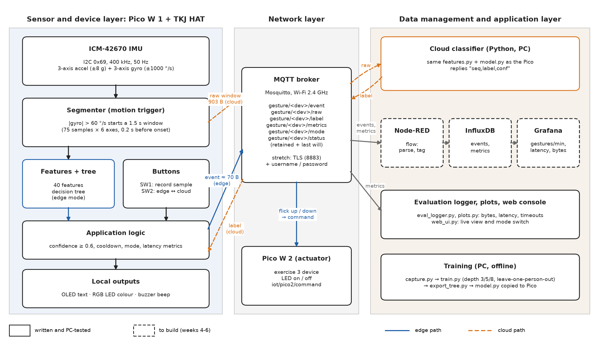

# Group 13: Edge-ML Gesture Controller

Team outline and workflow. Members: Syed Amin Al Mahim, Duong Vo, Yumish Niroula.
Course: 521043S Internet of Things, University of Oulu, autumn 2026. Updated 11 Nov 2026.

The document we hand in on 27.11 is `plan/plan-group13.tex` (compile it on Overleaf from `plan/plan-group13-overleaf.zip`). This file is the working version for the three of us: what we build, in which order, and who does what.

## 1. What we build

A hand-held controller. You do a gesture with the board in your hand, the Pico W recognises it, and something happens: the OLED, LED and buzzer react, a second Pico W switches its LED, and the event is stored and shown on a dashboard.

The question for the report is where the recognition should run. We build it two ways with the same model and measure them:

- **Edge:** the Pico classifies the gesture itself and sends only the result (about 70 bytes).
- **Cloud:** the Pico sends the raw sensor window (903 bytes) to a server, which classifies it and replies.

Gestures: shake, circle, flick up, flick down. A fifth class, "idle", is for ordinary movements that are not gestures, so the controller learns what to ignore.

## 2. Hardware

We have it already (photos from 6 Nov): the TKJ HAT from Computer Systems, mounted on a Raspberry Pi Pico WH (a Pico W with headers), in the red hand-held case.

| HAT part | Used for | Connection |
|---|---|---|
| ICM-42670 accelerometer + gyroscope | Gesture sensing, 50 Hz | I2C address 0x69, SDA GPIO 12, SCL GPIO 13 |
| SSD1306 OLED 128×64 | Gesture, confidence, mode | I2C address 0x3C |
| RGB LED | One colour per gesture | GPIO 18, 19, 20 |
| Buzzer | Beep on a gesture | GPIO 17 |
| Buttons SW1, SW2 | Record a sample; switch mode | GPIO 2, GPIO 22 |

We also need a second Pico W from the IoT course kit for the lamp LED, and a laptop for the broker.

### Board checklist (Duong)

Do these in order and post the output in the group chat. It takes about an hour.

1. Flash MicroPython: hold BOOTSEL while plugging in USB, then copy the **Pico W** `.uf2` file from micropython.org onto the drive that appears.
2. Open Thonny, choose "MicroPython (Raspberry Pi Pico)" and copy `pico/hat.py` and `pico/features.py` to the board.
3. In the Thonny shell:
   ```python
   import hat; i = hat.make_i2c(); print(i.scan())   # expect [16, 60, 64, 105]
   imu = hat.ICM42670(i); print(imu.read())          # flat on the table: third number near 1.0, last three near 0
   ```
4. Install the display driver: in Thonny, Tools → Manage packages → search `ssd1306` → install. Then:
   ```python
   d = hat.Display(i); d.show("GROUP 13", "hello")
   ```
5. Test the outputs and buttons:
   ```python
   led = hat.RGBLed(); led.set(255, 0, 0)            # red, then try (0,255,0) and (0,0,255)
   hat.Buzzer().beep()
   b = hat.Button(hat.SW1_PIN); print(b.pressed())   # hold SW1 while running this: True
   ```
6. Run `pico/collect.py`. Press SW1, do a shake, and check that one long line starting with `G,` is printed.
7. Find out how the board is powered away from the laptop. A USB power bank is the safe choice.

If a step fails, send the exact error text. The driver was written from the SDK's register list and has never run on the real sensor, so a problem in step 3 is likely ours to fix, not a broken board.

## 3. Architecture



Three layers, as the course template asks:

1. **Sensor and device layer.** The Pico reads the motion sensor at 50 Hz. When a movement starts (rotation above 60 °/s) it cuts a 1.5 s window, computes 40 features and runs a decision tree. Then it drives the OLED, LED and buzzer.
2. **Network layer.** MQTT over Wi-Fi, Mosquitto broker. Topics are under `gesture/<device>/`: `event`, `raw`, `label`, `metrics`, `mode`, `status`. Flick up and flick down also send `on` and `off` to `iot/pico2/command`.
3. **Data management layer.** A Python service classifies raw windows in cloud mode. Node-RED writes events and measurements to InfluxDB, and Grafana shows them. A logger saves the measurements to CSV for the report plots.

Course requirements covered: the three required ones (sensing, processing on the Pico, output control) plus wireless, edge ML and cloud integration. Security (TLS and a password on the broker) is a stretch goal.

## 4. Workflow, step by step

Each step has a check, so we know when it is done. Commands are run from the `project/` folder.

| # | Step | Done when |
|---|---|---|
| 0 | Get the code. Run `python tests/test_project.py` on your own PC. | 22 of 22 tests pass |
| 1 | Board check. Flash MicroPython for the Pico W, copy `pico/hat.py`, run the two lines in `README.md`. | The I2C scan shows 16, 60, 64 and 105. Flat on the table, the z acceleration is near 1.0. The OLED shows text. |
| 2 | Agree on the gestures: how to hold the case, how big and how fast each gesture is. Write it down in two lines each. | All three of us do them the same way |
| 3 | Record data. Run `pico/collect.py` on the board and `python pc/capture.py --port COMx --person <name> --out data/<name>.csv` on the PC. 50 of each class per person. | Three CSV files with about 250 recordings each |
| 4 | Train. `python pc/train.py "data/*.csv"`. | `results/` has the accuracy per depth, per person, the baselines and confusion matrices. `pico/model.py` is replaced by the real model. |
| 5 | Run the app on the Pico (`main.py`, `model.py`, `config.py`) with the broker on a laptop. | Edge mode shows the right gesture on the OLED and the second Pico's LED follows flick up and down |
| 6 | Cloud mode. Start `python pc/cloud_classifier.py --broker <ip>` and press SW2. | Same gestures work with the server doing the classification |
| 7 | Storage and dashboard. Node-RED → InfluxDB → Grafana, starting from the exercise 4 and 5 stack in `exercises/stack/`. | Gestures and latency show up in Grafana |
| 8 | Evaluation runs with `pc/eval_logger.py`, then `pc/plots.py`. Run `pico/bench.py` on the board. | CSV files and the four plots exist |
| 9 | Report, GitHub site, demo rehearsal, backup video. | Submitted by Tue 22.12 |

## 5. Who does what

| Person | Main area | First task |
|---|---|---|
| Syed Amin Al Mahim | Pico firmware, ML pipeline, report | Put the code on GitHub, fix what the board check finds |
| Duong Vo | Board check, data collection, evaluation runs | Step 1 on the real board |
| Yumish Niroula | Broker, second Pico W, Node-RED, InfluxDB, Grafana | Mosquitto on a laptop and the exercise 3 code on the second Pico |

Everybody records gesture data. Everybody reads the code: at the demo each of us has to be able to explain it.

## 6. Timeline

| By | Done |
|---|---|
| Fri 13.11 | Steps 0 to 2. Code on GitHub. |
| Tue 17.11 | Steps 3 and 4. First real model running on the Pico. |
| Fri 20.11 | Steps 5 and 6: edge mode, second Pico, cloud mode. |
| Fri 27.11 | **Plan PDF submitted** (one member, file name contains "13"). Step 7: dashboard. |
| Tue 1.12 | Step 8: evaluation runs and plots. |
| Fri 4.12 | Report draft, GitHub site, demo rehearsed, backup video. |
| Mon 7.12 | **Everything ready to submit.** Only small fixes after this. |
| Tue 22.12 | Course deadline (hard). Demo after that. |

We aim to be finished two weeks before the course deadline. Mahim has his thesis defence on 20 December, so the last two weeks cannot be used for project work.

## 7. Evaluation, fixed before we collect data

Two comparisons:

1. **Edge vs cloud**, same model. Each of us does 20 of each gesture and 20 idle movements in each mode. We measure bytes per window, latency (from window complete to label known, timed on the Pico), timeouts, and what happens when Wi-Fi is switched off for two minutes.
2. **Tree depth 3, 5 and 8.** Accuracy when the tree is tested on a person it was not trained on, time on the Pico, code size and memory.

Rules we commit to now:

- Edge uses less traffic if it sends at most one tenth of the bytes of cloud mode.
- Edge is faster if the 95% interval of the latency difference is above zero. We call it noticeable only above 100 ms.
- Edge is robust if every gesture still gives local feedback while Wi-Fi is off.
- We deploy the smallest depth that is within 2 points of the best one.
- The controller is usable for a new person if macro-F1 is at least 0.80 and it beats two simple baselines (most common class; thresholds on the amount of rotation only). If not, we report that.

We also count false gestures during 10 minutes of normal activity.

## 8. Status on 11 Nov

Done:
- All code is written: Pico app, drivers, data collection, training, exporter, cloud classifier, logger, plots, web console.
- 22 tests pass on a PC with fake hardware and made-up gestures.
- The plan for 27.11 is drafted with the architecture diagram.

Not done:
- **Nothing has run on the real board yet.** Step 1 is the first real test.
- No real gesture data. `pico/model.py` is a placeholder trained on made-up gestures. The 100% accuracy in `results/synthetic_demo/` means nothing for the real device.
- Node-RED, InfluxDB and Grafana for this project.
- TLS is written but untested.

## 9. What changed in the review on 11 Nov

- The web console (`pc/web_ui.py`) had a simulator that invented latency and confidence values and mixed them into its evaluation table and CSV export. Now simulated rows are marked, timed honestly as PC time, and kept out of the summary and the export. Only rows from the real Pico count.
- The model and results that were in the repository came from made-up gestures. They are now labelled and moved to `results/synthetic_demo/`.
- Hybrid mode now falls back to the Pico's own answer if the server does not reply.
- A malformed reply from the server no longer crashes the Pico's loop.
- Bytes are counted the same way in every mode (raw window, label reply and event).
- Cloud latency is checked every 2 ms while a reply is pending, not every 20 ms.
- Training now also writes macro-F1, the result per person and the two baselines. The plots script prints the bootstrap confidence intervals the plan promises.
- Claims we cannot back up yet were removed from this file: a cloud server on CSC cPouta, inference time below 0.2 ms, and the web console as a "mobile app".

## 10. Open decisions for the three of us

1. **Where the server runs.** A laptop in the same Wi-Fi is the simple start. A virtual machine on CSC cPouta would make "cloud" real, but we need access first. Does anyone have a CSC project?
2. **Hybrid mode.** It only makes sense with a bigger tree on the server than on the Pico. Keep it as an extra, or leave it out of the report?
3. **Security.** TLS and a broker password as a fourth optional feature, only if the rest is finished.
4. **Web console.** Useful for the demo. Ask the teachers before calling it a mobile app.
5. **Was the group and idea registered by 10.11?** If not, do it today.

## 11. Rules

- AI tools are allowed and we declare them (see `AI-USE.md`). Copying from other students is not.
- We cite what we reuse: the TKJHAT SDK (MIT, University of Oulu) for pins and sensor registers, scikit-learn, umqtt.simple, the ssd1306 driver.
- Never put Wi-Fi passwords in the repository. `config.py` stays on your own machine.
