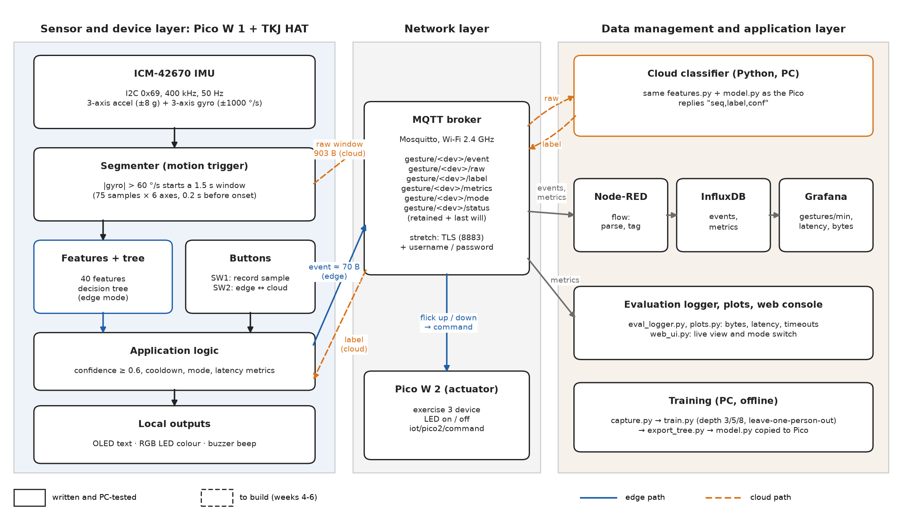
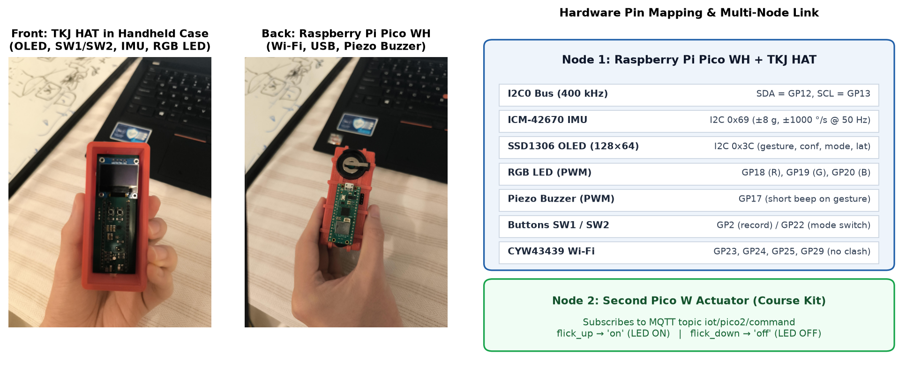
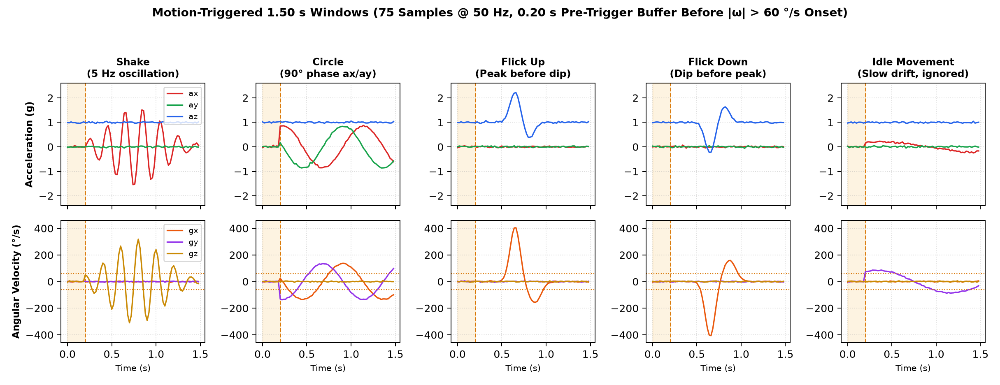
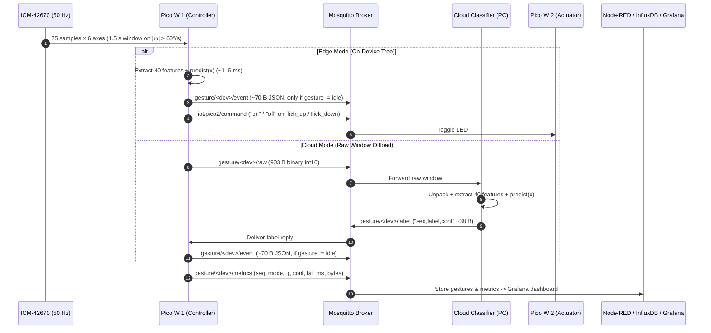
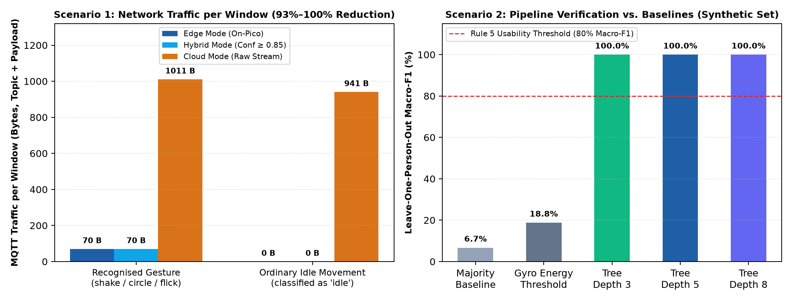

# Edge-ML Gesture Controller (group 13)

A Pico W with the TKJ HAT recognises gestures (shake, circle, flick up, flick down) with a decision tree running on the device. It sends MQTT commands and compares on-device ("edge") with server ("cloud") classification. The team outline and workflow are in [PROJECT_PLAN.md](PROJECT_PLAN.md). The plan we hand in is [plan/plan-group13.tex](plan/plan-group13.tex).

**Status (12 Nov 2026):** all code (firmware, PC pipeline, Web UI with session coach, Docker stack for Mosquitto + Node-RED + InfluxDB + Grafana, and docs site) is written and passes 24 tests on the PC. **It has not run on a real Pico or HAT yet.** `pico/model.py` is a placeholder trained on made-up gestures, and `results/synthetic_demo/` holds its results. They say nothing about the real device. Real results go in `results/` once the group has recorded data.

---

## System Architecture & Visuals

### 1. Three-Layer System Architecture


### 2. Group 13 Hardware (Pico WH + TKJ HAT in Handheld Case) & Pin Mapping


### 3. 5-Class IMU Gesture Signatures & Motion-Triggered Segmentation (1.50 s Window)


### 4. Edge vs. Cloud Protocol Sequence & Bandwidth Breakdown




---

## Files

| File | Runs on | What it does |
|---|---|---|
| `pico/hat.py` | Pico | TKJ HAT drivers: ICM-42670 IMU, RGB LED, buzzer, buttons, OLED. MicroPython port based on the TKJHAT SDK (cite it). |
| `pico/features.py` | Pico and PC | Feature extraction (40 numbers per window) and the `Segmenter` that cuts a window when a movement starts. One shared file, so training and the device compute the same thing. |
| `pico/collect.py` | Pico | Data collection: SW2 picks the label, SW1 arms the recorder |
| `pico/main.py` | Pico | The gesture app: edge/cloud mode (SW2 or MQTT), outputs, MQTT events, metrics. Hybrid mode (MQTT only) is an extra. |
| `pico/net.py` | Pico | Wi-Fi + MQTT that reconnects in the background without stopping gesture recognition |
| `pico/bench.py` | Pico | Times feature extraction and each tree depth on the device |
| `pico/config.example.py` | Pico | Copy to `config.py` and fill in |
| `pc/capture.py` | PC | Saves recordings from USB serial to `data/<person>.csv` |
| `pc/train.py` | PC | Compares depths 3/5/8 (leave-one-person-out), saves confusion matrices, per-person results and two baselines, writes `pico/model.py` |
| `pc/export_tree.py` | PC | Turns the scikit-learn tree into plain MicroPython `if/else` code (our own exporter) |
| `pc/cloud_classifier.py` | PC | Cloud mode: classifies raw windows with the same model and replies |
| `pc/eval_logger.py` | PC | Logs the Pico's metrics to CSV during evaluation runs |
| `pc/plots.py` | PC | Summary table with bootstrap confidence intervals, and plots for the report |
| `pc/web_ui.py` | PC | Web console: live gestures and metrics from MQTT, mode switch, lamp on/off, interactive session coach & pacer. Its simulator is for demos only: simulated rows never enter the hardware summary or the CSV export. |
| `stack/` | Docker | Mosquitto broker, Node-RED flow (`nodered/flows.json`), InfluxDB v2 and provisioned Grafana dashboard (`grafana/dashboards/gesture_controller.json`) |
| `docs/index.html` | Docs | GitHub Pages project website and print-to-PDF report template |
| `PROJECT_PLAN.md` | Docs | Team outline and workflow: steps, who does what, timeline, open decisions |
| `tests/test_project.py` | PC | 24 tests with fake hardware, stack validation, plus a real MQTT broker test |

## Setup

**PC:**
```bash
pip install numpy scikit-learn matplotlib paho-mqtt pyserial
```

**Pico W:**
1. Flash MicroPython for the Pico W and mount the HAT.
2. Install the two libraries from the Pico's REPL (with Wi-Fi connected):
   ```python
   import mip; mip.install("umqtt.simple"); mip.install("ssd1306")
   ```
3. Copy `hat.py`, `features.py`, `net.py`, `main.py` and your `config.py` to the Pico.

**First check (week 1):** in the REPL, check that the IMU and display respond on the Pico W:
```python
import hat; i = hat.make_i2c(); print(i.scan())   # expect 16, 60, 64, 105 (0x10, 0x3C, 0x40, 0x69)
imu = hat.ICM42670(i); print(imu.read())          # flat on the table: az near 1.0, gyro near 0
```

## Workflow

1. **Collect data.** Each member records about 50 of each gesture, including "idle": ordinary movements that are not gestures.
   - Run `collect.py` on the Pico, close Thonny, then on the PC:
     ```bash
     python pc/capture.py --port COM5 --person m1 --out data/m1.csv
     ```
   - Hold and move the board the same way each time, and agree on that in the group.
2. **Train:**
   ```bash
   python pc/train.py "data/*.csv" --depth 5
   ```
   This writes `pico/model.py`, plus `results/depth_results.csv`, `results/per_person.csv`, `results/baselines.csv`, `results/confusion_depth*.png` and `results/model_d*.py`.
3. **Run the app.** Copy `model.py` to the Pico. `main.py` starts on boot.
4. **Second device:** a second Pico running the code in `pico2/` (see its README) turns its LED on and off with flick up and flick down (see `ACTIONS` in the config).
5. **Evaluate:**
   ```bash
   python pc/cloud_classifier.py --broker <ip>
   python pc/eval_logger.py --broker <ip> --mode edge  --out results/edge.csv
   python pc/eval_logger.py --broker <ip> --mode cloud --out results/cloud.csv
   ```
   - Do the same set of gestures in each mode, for example 20 of each.
   - For the Wi-Fi drop test, turn off the hotspot during a run. Edge keeps working on the Pico; cloud logs timeouts.
   - Copy `results/model_d*.py` to the Pico, run `bench.py`, and save its CSV output as `results/bench.csv`.
   - Make the plots:
     ```bash
     python pc/plots.py "results/edge.csv" "results/cloud.csv"
     ```
6. **Tests:**
   ```bash
   python tests/test_project.py
   ```

## Design notes for the report and demo

- **Motion-triggered windows.** A window starts 0.2 s before the rotation speed passes 60 deg/s, and is classified once it is complete (1.5 s). Collection and the live app use the same `Segmenter`, so the training windows line up like the live ones. A plain sliding window was tried first: in the tests it classified half-finished shakes as "circle".
- **Same model in both modes.** The cloud classifier imports the same `features.py` and `model.py`, so edge vs cloud compares only *where* the work happens, not the accuracy.
- **What is measured.** Latency runs from "window complete" to "label known on the Pico", timed with `ticks_ms` on the Pico, so no clock synchronisation is needed. Bytes are MQTT payload plus topic for every message a window causes: the event in edge mode; the raw window, the label reply and the event in cloud mode. The metrics messages and the command to the second Pico are not counted. While a reply is pending, the Pico checks for it every 2 ms.
- **Raw window size.** 6 axes × 75 samples × 2 bytes + 3 header bytes = 903 bytes, sent as int16 in mg and 0.1 deg/s. Edge mode sends about 70 bytes, and only when a gesture is recognised. Cloud mode sends and receives about 1,030 bytes for a gesture and about 960 for an idle movement.
- **Sensor ranges.** The IMU is set to ±8 g and ±1000 deg/s, wider than the SDK default (±4 g, ±250 deg/s), because shakes and flicks would clip.
- **Known limits.**
  - Feature extraction on the Pico may take long enough to delay one sample. The loop resyncs; `bench.py` measures it.
  - umqtt.simple sends at QoS 0 here. MQTT connect can block briefly when the broker is unreachable.
  - TLS (`MQTT_SSL` in the config) is written but not tested on hardware.
  - Hybrid mode only helps if the server runs a bigger tree: `python pc/cloud_classifier.py --model results/model_d8.py`.
- **Credits.** The TKJHAT SDK (MIT, University of Oulu, Raisul Islam and Iván Sánchez Milara) is the reference for pins and IMU registers. scikit-learn, umqtt.simple and the ssd1306 driver are libraries. The application logic, features, exporter and evaluation are ours.
